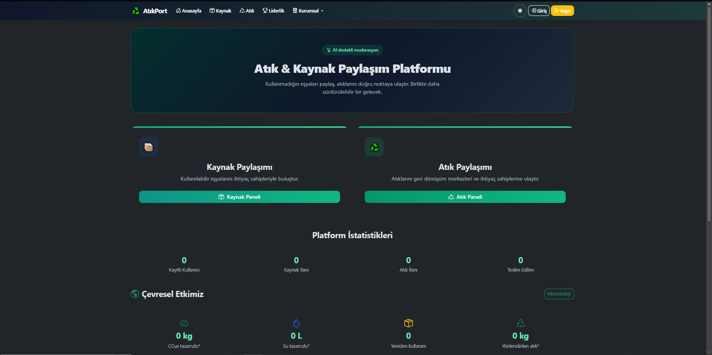
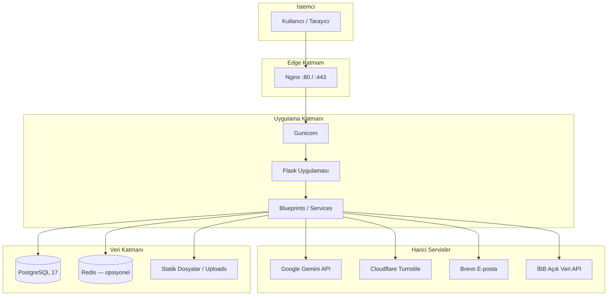
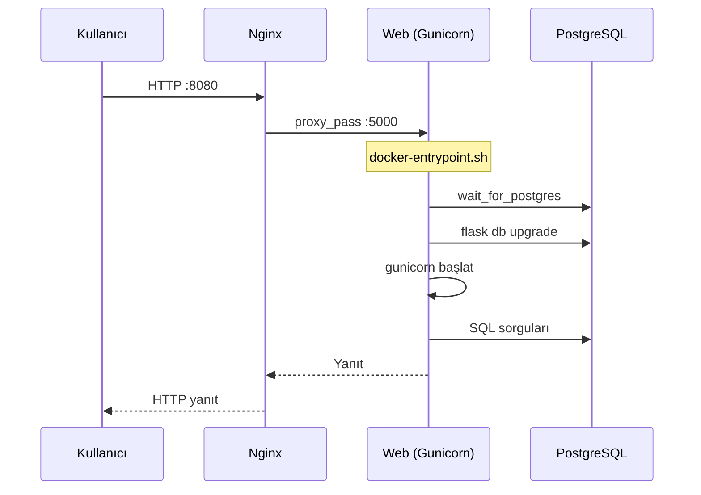

<div align="center">

# AtıkPort

**AI destekli atık ve kaynak paylaşım platformu**

Kullanılmayan eşyaları yeniden kullanıma kazandırın, atıkları doğru kanallara yönlendirin.

[](https://www.python.org/)
[](https://flask.palletsprojects.com/)
[](https://www.postgresql.org/)
[](https://www.docker.com/)
[](LICENSE)
[](tests/)

[Özellikler](#özellikler) · [Kurulum](#kurulum) · [Docker](#docker-kurulumu) · [API](#api-endpointleri) · [Güvenlik](#güvenlik) · [Katkıda Bulunma](#katkıda-bulunma)


*Ekran görüntüsü yer tutucusu — `docs/screenshots/home.png`*

</div>

---

## Projenin Amacı

AtıkPort, sürdürülebilir tüketim ve döngüsel ekonomi hedeflerine katkı sağlamak için tasarlanmış bir **paylaşım platformudur**. Kullanıcılar kullanılmayan eşyalarını **kaynak** olarak paylaşabilir, geri dönüştürülmesi gereken malzemeleri **atık** ilanıyla topluluğa sunabilir.

Platform, **Google Gemini** yapay zekâsını kullanarak:

- İlan görsellerinden **otomatik kategori tahmini** yapar
- Uygunsuz içerikleri **AI moderasyon** ile filtreler
- Mesaj ve yorumlarda **içerik denetimi** uygular

Böylece hem kullanıcı deneyimi iyileştirilir hem de topluluk güvenliği güçlendirilir. Kurumsal analiz paneli, çevresel etki ölçümü ve gamification özellikleriyle platform ölçülebilir sürdürülebilirlik etkisi sunar.

---

## Özellikler

| Alan | Özellik |
|------|---------|
| 🤖 **Yapay Zekâ** | AI moderasyon · AI kategori belirleme · Mesaj/yorum denetimi |
| 📦 **İlanlar** | Kaynak paylaşımı · Atık paylaşımı · Durum yönetimi (Aktif / Rezerve / Teslim Edildi) |
| 👤 **Kullanıcı** | Profiller · Profil fotoğrafı · E-posta doğrulama · Şifre sıfırlama |
| 💬 **Etkileşim** | Mesajlaşma · Favoriler · Bildirimler · Yorumlar · Şikayet sistemi |
| 🗺️ **Harita** | Atık merkezleri (İBB açık veri) · Konum seçimi · Isı haritası (kurum) |
| 📷 **Medya** | Güvenli fotoğraf yükleme · Görsel galeri · EXIF temizleme |
| 🔒 **Güvenlik** | Turnstile CAPTCHA · Rate limiting · CSRF · CSP (Talisman) · Secure cookies |
| 🏗️ **Altyapı** | Docker · PostgreSQL · Flask-Migrate · Logging · Health check |
| 🏆 **Ek** | Gamification (rozetler, liderlik) · Çevresel etki paneli · Admin paneli |

---

## Kullanılan Teknolojiler

### Frontend

| Teknoloji | Kullanım |
|-----------|----------|
| 🎨 **Bootstrap 5** | Responsive UI, bileşenler |
| 🧩 **Bootstrap Icons** | İkon seti |
| 📝 **Jinja2** | Sunucu taraflı şablonlar |
| 🗺️ **Leaflet** | Harita ve ısı katmanı |
| ⚡ **Vanilla JS** | Dinamik UI, AJAX, form doğrulama |

### Backend

| Teknoloji | Kullanım |
|-----------|----------|
| 🐍 **Python 3.12** | Ana dil |
| 🌶️ **Flask 3** | Web framework |
| 🔐 **Flask-Login** | Oturum yönetimi |
| 📋 **Flask-WTF** | Formlar ve CSRF |
| 📧 **Flask-Mail** | E-posta (Brevo SMTP / REST) |
| ⏱️ **Flask-Limiter** | Rate limiting |
| 🛡️ **Flask-Talisman** | CSP ve güvenlik başlıkları |
| 🔄 **Flask-Migrate** | Alembic veritabanı migration |
| 🦄 **Gunicorn** | Production WSGI sunucusu |

### Veritabanı

| Teknoloji | Kullanım |
|-----------|----------|
| 🐘 **PostgreSQL 17** | Production veritabanı |
| 📁 **SQLite** | Yerel geliştirme |
| 🔗 **SQLAlchemy 2** | ORM |
| 🧬 **Alembic** | Şema versiyonlama |

### AI

| Teknoloji | Kullanım |
|-----------|----------|
| ✨ **Google Gemini** | Görsel analiz, kategori, moderasyon |
| 📦 **google-genai** | Resmi Python SDK |
| 🖼️ **Pillow** | Görsel işleme |

### Deployment

| Teknoloji | Kullanım |
|-----------|----------|
| 🐳 **Docker** | Container imajı |
| 📦 **Docker Compose** | Çoklu servis orkestrasyonu |
| 🌐 **Nginx** | Reverse proxy, statik dosya |
| 🔴 **Redis** | Rate limit depolama (opsiyonel) |

### Security

| Teknoloji | Kullanım |
|-----------|----------|
| 🛡️ **OWASP Top 10** | Tasarım ve test prensipleri |
| 🔒 **CSRF** | Flask-WTF token koruması |
| 📜 **CSP** | Flask-Talisman içerik politikası |
| 🤖 **Cloudflare Turnstile** | Bot koruması |
| 🔑 **Passlib (pbkdf2)** | Şifre hashleme |
| 🧹 **Bleach** | XSS önleme (input sanitization) |

---

## Sistem Mimarisi



**Production akışı:** Kullanıcı → Nginx → Gunicorn → Flask → PostgreSQL / Gemini AI

---

## Proje Yapısı

```
sosyal-atik-platformu/
├── app.py                      # Uygulama giriş noktası
├── factory.py                  # Flask app factory
├── models.py                   # SQLAlchemy modelleri
├── security.py                 # Talisman, CSP yapılandırması
├── helpers.py                  # Gemini AI entegrasyonu
├── constants.py                # Kategori ve sabitler
├── extensions.py               # Flask eklentileri (db, mail, limiter…)
├── blueprints/                 # Route modülleri
│   ├── auth.py                 # Kayıt, giriş, profil, e-posta
│   ├── kaynak.py               # Kaynak ilanları
│   ├── atik.py                 # Atık ilanları
│   ├── ilan.py                 # İlan yönetimi
│   ├── messages.py             # Mesajlaşma
│   ├── api.py                  # REST/AJAX endpointleri
│   ├── admin.py                # Admin paneli
│   ├── kurum.py                # Kurumsal analiz
│   ├── gamification.py         # Rozetler, liderlik
│   └── impact.py               # Çevresel etki
├── services/                   # İş mantığı servisleri
│   ├── email.py                # E-posta gönderimi
│   ├── content_filter.py       # AI + kelime filtresi
│   ├── database_config.py      # DB URI çözümlemesi
│   ├── logging_setup.py        # Loglama ve hata sayfaları
│   └── …
├── templates/                  # Jinja2 HTML şablonları
├── static/                     # CSS, JS, vendor, uploads
├── migrations/                 # Alembic revision'ları
├── tests/                      # pytest test paketi
├── scripts/                    # Yardımcı scriptler
│   ├── migrate_sqlite_to_postgres.py
│   ├── wait_for_postgres.py
│   └── backup_db.py
├── deploy/                     # Production deployment
│   ├── docker-compose.prod.yml
│   ├── nginx.http.conf
│   └── nginx.conf
├── docker-entrypoint.sh        # wait → migrate → gunicorn
├── Dockerfile
├── docker-compose.yml          # Yerel geliştirme (SQLite)
└── .env.example
```

---

## Kurulum

### Gereksinimler

- Python 3.12+
- pip
- (Opsiyonel) PostgreSQL 17 veya Docker

### Adımlar

```bash
# Depoyu klonlayın
git clone https://github.com/YusufSez/sosyal-atik-platformu.git
cd sosyal-atik-platformu

# Sanal ortam
python -m venv venv
venv\Scripts\activate          # Windows
# source venv/bin/activate     # Linux / macOS

# Bağımlılıklar
pip install -r requirements.txt

# Ortam değişkenleri
copy .env.example .env           # Windows
# cp .env.example .env           # Linux / macOS
# .env içinde SECRET_KEY ve GEMINI_API_KEY tanımlayın

# Veritabanı şeması
set FLASK_APP=app.py             # Windows CMD
# export FLASK_APP=app.py        # Linux / macOS
flask db upgrade

# (Opsiyonel) Örnek veri
python migration.py

# Uygulamayı başlatın
python app.py
```

Uygulama varsayılan olarak **http://127.0.0.1:5000** adresinde çalışır.

### Admin kullanıcısı

```sql
UPDATE "user" SET is_admin = 1 WHERE email = 'sizin@email.com';
```

Ardından `/admin` sayfasına erişebilirsiniz. İlk kayıtta `ADMIN_EMAIL` ortam değişkenindeki adres otomatik admin olur.

---

## Docker Kurulumu

### Yerel geliştirme (SQLite)

Tek komutla çalıştırma:

```bash
docker compose up --build
```

Uygulama **http://localhost:5000** adresinde açılır.

### Production (PostgreSQL + Nginx)

Önkoşul — proje kökünde `.env`:

```env
SECRET_KEY=...
POSTGRES_PASSWORD=guclu-sifre
SITE_URL=http://localhost:8080
USE_POSTGRES=True
POSTGRES_DB=atikport
POSTGRES_USER=postgres
```

```bash
cd deploy
docker compose -f docker-compose.prod.yml up --build -d
```

| Servis | Açıklama |
|--------|----------|
| `postgres` | PostgreSQL 17, kalıcı `pgdata` volume |
| `web` | Gunicorn; `flask db upgrade` otomatik |
| `nginx` | Reverse proxy → **http://localhost:8080** |

### Redis (isteğe bağlı)

Redis **zorunlu değildir**. Tanımlı değilse rate limit, Socket.IO ve diğer bileşenler mevcut `memory://` davranışıyla çalışır.

**Ne zaman önerilir?**

- Gunicorn **birden fazla worker** ile çalıştırıldığında (rate limit tutarlılığı)
- Socket.IO **message queue** ile worker'lar arası olay yayını
- İleride paylaşımlı cache / presence state taşınması planlandığında

**Production'da Redis ile başlatma:**

```bash
# .env dosyasına ekleyin:
# REDIS_URL=redis://redis:6379/0

cd deploy
docker compose --profile redis -f docker-compose.prod.yml up --build -d
```

`REDIS_URL` tanımlandığında uygulama otomatik olarak Redis'i dener; bağlantı başarısız olursa **uygulama kapanmaz**, WARNING log üretir ve **memory fallback** kullanır.

Durum kontrolü:

```bash
docker compose -f docker-compose.prod.yml ps
curl http://localhost:8080/health
# Örnek: {"status":"ok","database":"up","redis":"healthy","storage":"redis"}
# Redis yoksa: "redis":"disabled", "storage":"memory"
```


*Ekran görüntüsü yer tutucusu — production stack*

---

## CI

GitHub Actions ile her `push` ve `pull_request` (hedef dallar: `main`, `develop`) otomatik doğrulanır. Workflow yalnızca CI içindir; production deploy yapmaz ve GitHub Secrets gerektirmez.

### Ne yapıyor?

| Job | Adımlar |
|-----|---------|
| **Tests** | Python 3.12, `pip install -r requirements.txt`, minimal `ruff` syntax kontrolü, `pytest` (tüm testler) |
| **Docker build** | `docker build .` ve `docker compose build` (container başlatılmaz) |

Test job ortam değişkenleri: `TESTING=True`, `SECRET_KEY`, `DATABASE_URL=sqlite://`, `MAIL_SUPPRESS_SEND=True`, `USE_POSTGRES=False`, `FLASK_ENV=testing`. Bağımlılıklar `actions/setup-python` pip cache ile hızlandırılır.

`pytest` veya Docker build başarısız olursa workflow kırmızıya düşer ve merge engellenir (branch protection tanımlıysa).

### Nasıl çalışıyor?

1. Depoya push veya PR açıldığında `.github/workflows/ci.yml` tetiklenir.
2. **Tests** job'ı test ortamını kurar ve tüm test suite'i çalıştırır.
3. **Docker build** job'ı imajın derlenebildiğini doğrular (çalıştırma yok).
4. İki job da yeşilse CI geçmiş sayılır.

Yerel geliştirme etkilenmez; workflow yalnızca GitHub runner üzerinde çalışır.

### Badge

`README.md` üstüne (veya istediğiniz yere) aşağıdaki satırı ekleyin (`OWNER` ve `REPO` değerlerini kendi deponuzla değiştirin):

```markdown
[](https://github.com/OWNER/REPO/actions/workflows/ci.yml)
```

Private repolarda badge, depoya erişimi olan kullanıcılara görünür.

---

## PostgreSQL Kurulumu

### Yerel PostgreSQL

`.env` dosyasında:

```env
USE_POSTGRES=True
POSTGRES_HOST=localhost
POSTGRES_PORT=5432
POSTGRES_DB=atikport
POSTGRES_USER=postgres
POSTGRES_PASSWORD=guclu-sifre
AUTO_CREATE_DB=False
```

```bash
flask db upgrade
python app.py
```

### Migration komutları

```bash
flask db upgrade              # Şemayı güncelle
flask db migrate -m "mesaj"   # Yeni revision oluştur
flask db current              # Mevcut revision
flask db downgrade            # Bir adım geri (dikkatli)
flask db stamp head           # Mevcut şemayı işaretle
```

SQLite ve PostgreSQL **aynı Alembic revision dosyalarını** kullanır.

### SQLite → PostgreSQL veri aktarımı

**Yerel:**

```bash
flask db upgrade
python scripts/migrate_sqlite_to_postgres.py --sqlite-path site.db
```

**Docker:**

```bash
cd deploy
docker compose -f docker-compose.prod.yml --profile migrate run --rm migrate-sqlite
```

Mevcut PostgreSQL verisinin üzerine yazmak için:

```bash
docker compose -f docker-compose.prod.yml --profile migrate run --rm \
  --entrypoint /bin/sh migrate-sqlite -c \
  "python scripts/wait_for_postgres.py && python scripts/migrate_sqlite_to_postgres.py --sqlite-path /import/site.db --reset"
```

---

## Environment Variables

| Değişken | Zorunlu | Açıklama |
|----------|---------|----------|
| `SECRET_KEY` | ✅ | Flask oturum güvenliği (min. 32 karakter) |
| `GEMINI_API_KEY` | ✅* | Google Gemini API anahtarı (*AI özellikleri için) |
| `SITE_URL` | ⚠️ | Kamuya açık site adresi; e-posta linkleri |
| `USE_POSTGRES` | — | `True` → PostgreSQL, `False` → SQLite |
| `POSTGRES_HOST` | — | `localhost` yerel, `postgres` Docker ağı |
| `POSTGRES_PASSWORD` | ✅† | PostgreSQL şifresi (†PG kullanımında) |
| `POSTGRES_DB` | — | Veritabanı adı (varsayılan: `atikport`) |
| `DATABASE_URL` | — | Tam bağlantı dizesi (öncelikli) |
| `AUTO_CREATE_DB` | — | Üretimde `False`; şema `flask db upgrade` ile |
| `FLASK_APP` | — | CLI giriş noktası (`app.py`) |
| `DEBUG` | — | Geliştirme modu |
| `TURNSTILE_SITE_KEY` | — | Cloudflare Turnstile site anahtarı |
| `TURNSTILE_SECRET_KEY` | — | Turnstile gizli anahtar |
| `TURNSTILE_ENABLED` | — | CAPTCHA etkinleştirme |
| `RATELIMIT_STORAGE_URI` | — | `memory://` veya `redis://...` |
| `MAIL_SERVER` | — | SMTP sunucusu (Brevo) |
| `MAIL_USERNAME` | — | SMTP kullanıcı adı |
| `MAIL_PASSWORD` | — | SMTP şifre / API key |
| `BREVO_API_KEY` | — | Brevo REST API (değişken IP ortamları) |
| `EMAIL_VERIFICATION_REQUIRED` | — | Kayıtta e-posta doğrulama zorunluluğu |
| `BEHIND_PROXY` | — | Nginx/Caddy arkasında `True` |
| `FORCE_HTTPS` | — | HTTPS yönlendirme ve secure cookie |
| `ENABLE_HSTS` | — | HSTS başlığı (ZAP taraması için) |
| `ADMIN_EMAIL` | — | Süper admin e-posta adresi |
| `ALLOW_SEED_ROUTE` | — | `/seed` demo endpoint'i |
| `LOG_DIR` | — | Log dizini (varsayılan: `logs`) |
| `BACKUP_ENABLED` | — | SQLite otomatik yedekleme |

Tam liste için [.env.example](.env.example) dosyasına bakın.

---

## Güvenlik

AtıkPort, **OWASP Top 10** prensiplerine uygun olarak tasarlanmış ve test edilmiştir.

| Önlem | Uygulama |
|-------|----------|
| **OWASP Top 10** | Injection, XSS, broken auth, misconfiguration vb. için testler ve savunmalar |
| **CSRF** | Flask-WTF token; tüm state-changing formlarda koruma |
| **Talisman** | Güvenlik HTTP başlıkları, HSTS, referrer policy |
| **CSP** | Sıkı Content-Security-Policy; nonce destekli script-src |
| **Secure Cookies** | `HttpOnly`, `SameSite=Lax`, HTTPS'te `Secure` |
| **Rate Limiting** | Flask-Limiter; endpoint bazlı limitler |
| **Turnstile** | Kayıt/giriş formlarında Cloudflare bot koruması |
| **E-posta Doğrulama** | Token tabanlı doğrulama; süre sınırlı linkler |
| **Şifre Güvenliği** | Passlib pbkdf2; güçlü SECRET_KEY zorunluluğu |
| **Upload Güvenliği** | MIME/uzantı doğrulama, EXIF temizleme, boyut limiti |
| **Input Sanitization** | Bleach ile HTML temizleme |
| **Audit Logging** | Admin işlemleri için denetim kaydı |

```bash
# Güvenlik testleri
pytest tests/test_security.py tests/test_csrf.py tests/test_upload_security.py -v
```

---

## AI Moderation

AtıkPort, **Google Gemini** (`gemini-2.5-flash`, yedek: `gemini-2.0-flash`) modelini üç ana alanda kullanır:

### 1. Görsel analiz ve kategori

İlan yüklenirken fotoğraf analiz edilir; kaynak veya atık türüne göre kategori önerilir.

```
Görsel + başlık + açıklama → Gemini → { kategori, güven_skoru, risk_skoru }
```

### 2. İlan moderasyonu

Uygunsuz görsel veya metin tespit edilirse ilan reddedilir. `AI_UPLOAD_FAIL_OPEN=False` (varsayılan) ile API kesintisinde **fail-closed** davranış uygulanır.

### 3. Mesaj ve yorum denetimi

`services/content_filter.py` önce Gemini AI moderasyonunu dener; API kullanılamazsa kelime listesi yedeği devreye girer.

```python
# helpers.py — mesaj moderasyon akışı
ai_sonuc = ai_mesaj_moderasyon(metin)
# → { uygun: bool, kaynak: "ai" | "liste", mesaj: str }
```

Manuel AI testi:

```bash
python scripts/check_ai.py
```

---

## API Endpointleri

### Sağlık ve genel

| Method | Endpoint | Açıklama | Auth |
|--------|----------|----------|------|
| `GET` | `/health` | Uygulama ve DB durumu | — |
| `GET` | `/` | Ana sayfa | — |
| `GET` | `/api/oneriler` | Önerilen ilanlar | — |

### Harita ve atık merkezleri

| Method | Endpoint | Açıklama | Auth |
|--------|----------|----------|------|
| `GET` | `/api/atik_merkezleri` | Atık toplama merkezleri | — |
| `GET` | `/api/en_yakin_merkezler/<lat>/<lng>` | En yakın merkezler | — |
| `GET` | `/api/kurum/isi-haritasi` | Kurum ısı haritası verisi | Kurum |

### İlanlar ve etkileşim

| Method | Endpoint | Açıklama | Auth |
|--------|----------|----------|------|
| `POST` | `/api/favori_ekle` | Favori ekle/kaldır | ✅ |
| `GET` | `/api/favori_kontrol` | Favori durumu | ✅ |
| `POST` | `/api/goruntulenme_ekle` | Görüntülenme sayacı | — |
| `GET` | `/api/goruntulenme_sayisi` | Görüntülenme sayısı | — |
| `POST` | `/api/sikayet` | İlan şikayeti | ✅ |
| `POST` | `/api/mesaj_sikayet` | Mesaj şikayeti | ✅ |

### Bildirimler

| Method | Endpoint | Açıklama | Auth |
|--------|----------|----------|------|
| `GET` | `/bildirimleri_getir` | Bildirim listesi | ✅ |
| `POST` | `/bildirim_okundu_isaretle/<id>` | Okundu işaretle | ✅ |
| `POST` | `/bildirimleri_okundu_isaretle` | Tümünü okundu işaretle | ✅ |

### Mesajlaşma

| Method | Endpoint | Açıklama | Auth |
|--------|----------|----------|------|
| `POST` | `/send_message` | Mesaj gönder | ✅ |
| `GET` | `/mesajlar_getir/<alici>/<kaynak>/<atik>` | Mesaj geçmişi | ✅ |

### Çevresel etki

| Method | Endpoint | Açıklama | Auth |
|--------|----------|----------|------|
| `GET` | `/api/etki/ozet` | Genel etki özeti | — |
| `GET` | `/api/etki/benim` | Kullanıcı etki özeti | ✅ |

### Kimlik doğrulama (sayfa)

| Method | Endpoint | Açıklama |
|--------|----------|----------|
| `GET/POST` | `/kayit` | Kayıt |
| `GET/POST` | `/giris` | Giriş |
| `GET` | `/cikis` | Çıkış |
| `GET/POST` | `/sifremi-unuttum` | Şifre sıfırlama talebi |
| `GET/POST` | `/sifre-sifirla/<token>` | Yeni şifre belirleme |
| `GET` | `/eposta-dogrula/onay/<token>` | E-posta doğrulama |

---

## Docker Deployment

Production stack `deploy/docker-compose.prod.yml` ile yönetilir.

**VPS / atikport.com yayını:** Ayrıntılı adımlar için [`deploy/DEPLOY.md`](deploy/DEPLOY.md) dosyasına bakın.

| Ortam | Komut |
|-------|-------|
| Yerel test | `docker compose -f deploy/docker-compose.prod.yml up -d` → `:8080` |
| VPS (HTTP, SSL öncesi) | `docker compose -f docker-compose.prod.yml -f docker-compose.vps-init.yml up -d` |
| VPS (HTTPS) | `docker compose -f docker-compose.prod.yml -f docker-compose.vps.yml --profile ssl up -d` |



### Servis detayları

| Servis | Image | Port | Volume |
|--------|-------|------|--------|
| `postgres` | `postgres:17` | 5432 (internal) | `pgdata` |
| `web` | `deploy-web` (build) | 5000 (internal) | uploads, logs |
| `nginx` | `nginx:1.27-alpine` | 8080→80 | config mount |

### Entrypoint akışı

1. `scripts/wait_for_postgres.py` — PostgreSQL hazır olana kadar bekler
2. `flask db upgrade` — Alembic migration (mevcut şema varsa `stamp head` fallback)
3. `gunicorn` — Production sunucu başlatılır

### SSL (atikport.com)

```bash
cd deploy
bash scripts/ssl-init.sh
```

Let's Encrypt sertifikası alınır ve HTTPS nginx'e geçilir. Yenileme: `--profile ssl`.

### Health check

```bash
curl http://localhost:8080/health
# {"database":"up","status":"ok"}
```

---

## Test

```bash
# Tüm testler
pytest tests/ -v

# Güvenlik odaklı
pytest tests/test_security.py tests/test_csrf.py tests/test_turnstile.py -v

# Veritabanı ve operasyon
pytest tests/test_database_config.py tests/test_ops.py -v
```

### OWASP ZAP

Production taraması için önerilen ortam değişkenleri:

```env
BEHIND_PROXY=True
ENABLE_HSTS=True
SITE_URL=https://alanadiniz.com
```

ZAP taramasını `http://localhost:8080` veya staging ortamında çalıştırın.

### Health Check

| Endpoint | Beklenen |
|----------|----------|
| `GET /health` | `200` — `{"status":"ok","database":"up"}` |
| Docker web healthcheck | Container `healthy` durumu |

---

## Yol Haritası

- [ ] **Mobil uygulama** — React Native / Flutter istemci
- [ ] **REST API v2** — Tam JSON API ve OpenAPI dokümantasyonu
- [ ] **Redis cluster** — Production rate limiting ve oturum paylaşımı
- [ ] **Otomatik yedekleme** — PostgreSQL `pg_dump` cron job
- [ ] **Çoklu dil (i18n)** — TR / EN dil desteği
- [ ] **Push bildirimleri** — Web Push / FCM entegrasyonu
- [ ] **Gelişmiş analitik** — Kurum dashboard genişletmesi
- [ ] **CI/CD pipeline** — GitHub Actions ile otomatik test ve deploy
- [ ] **Kubernetes Helm chart** — Ölçeklenebilir deployment

---

## Katkıda Bulunma

Katkılarınızı bekliyoruz! Lütfen aşağıdaki adımları izleyin:

1. **Fork** edin ve feature branch oluşturun
   ```bash
   git checkout -b feature/amazing-feature
   ```
2. Değişikliklerinizi yapın ve **testleri** çalıştırın
   ```bash
   pytest tests/ -v
   ```
3. Anlamlı commit mesajları yazın
4. Branch'inizi push edin ve **Pull Request** açın

### Geliştirme kuralları

- Yeni özellikler için test ekleyin
- Güvenlik değişikliklerinde `tests/test_security.py` güncelleyin
- Veritabanı değişikliklerinde `flask db migrate` kullanın
- Kod stili: mevcut proje konvansiyonlarına uyun
- Büyük değişiklikler için önce issue açarak tartışın

---

## Lisans

Bu proje [MIT Lisansı](LICENSE) altında lisanslanmıştır.

```
MIT License

Copyright (c) 2026 AtıkPort Contributors

Permission is hereby granted, free of charge, to any person obtaining a copy
of this software and associated documentation files (the "Software"), to deal
in the Software without restriction, including without limitation the rights
to use, copy, modify, merge, publish, distribute, sublicense, and/or sell
copies of the Software, and to permit persons to whom the Software is
furnished to do so, subject to the following conditions:

The above copyright notice and this permission notice shall be included in all
copies or substantial portions of the Software.

THE SOFTWARE IS PROVIDED "AS IS", WITHOUT WARRANTY OF ANY KIND, EXPRESS OR
IMPLIED, INCLUDING BUT NOT LIMITED TO THE WARRANTIES OF MERCHANTABILITY,
FITNESS FOR A PARTICULAR PURPOSE AND NONINFRINGEMENT. IN NO EVENT SHALL THE
AUTHORS OR COPYRIGHT HOLDERS BE LIABLE FOR ANY CLAIM, DAMAGES OR OTHER
LIABILITY, WHETHER IN AN ACTION OF CONTRACT, TORT OR OTHERWISE, ARISING FROM,
OUT OF OR IN CONNECTION WITH THE SOFTWARE OR THE USE OR OTHER DEALINGS IN THE
SOFTWARE.
```

---

<div align="center">

**AtıkPort** — Sürdürülebilir gelecek için paylaş, yeniden kullan, geri dönüştür.

[⬆ Başa dön](#atıkport)

</div>
